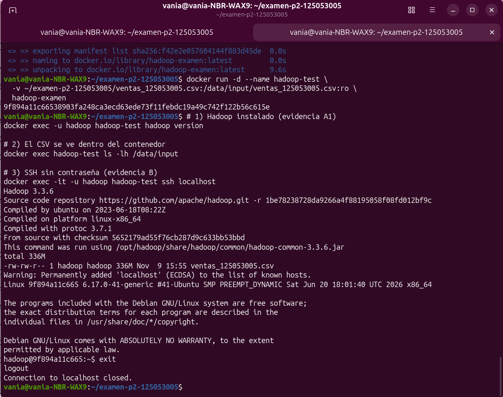
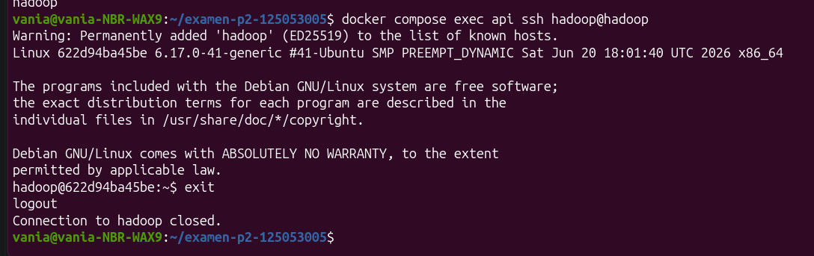
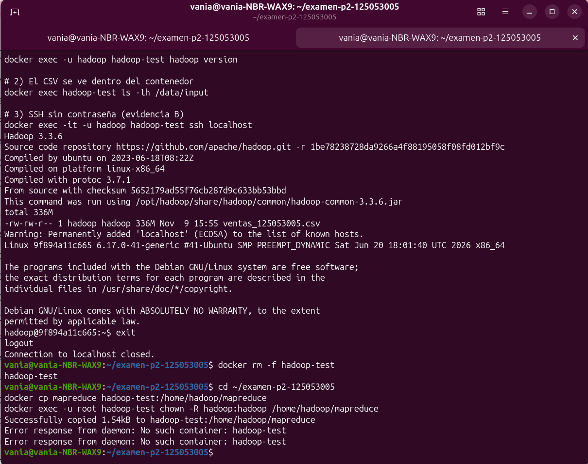
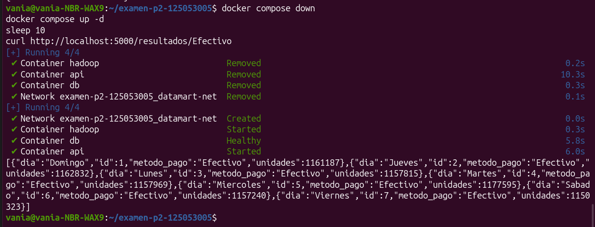
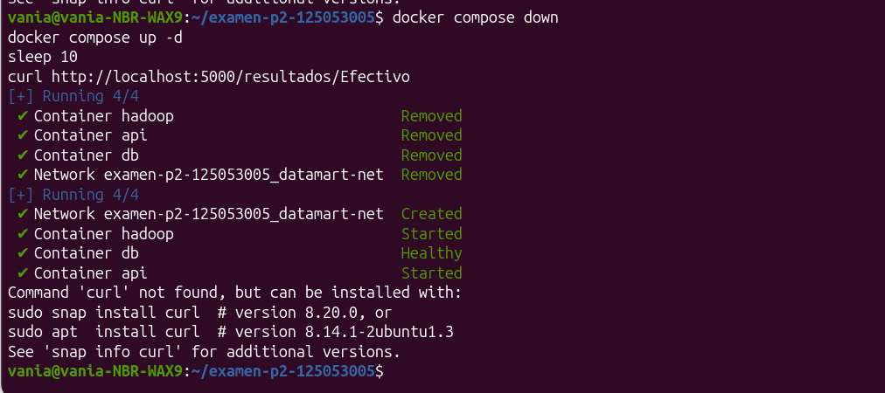

# Examen Segundo Parcial: Pipeline de datos contenerizado

**Alumna:** Vania
**Matrícula:** 125053005
**Pregunta asignada (último dígito 5):** Unidades vendidas por método de pago y día de la semana.

## Cómo reproducir

1. Colocar `ventas_125053005.csv` en la raíz del proyecto (no se sube al repo).
2. Copiar las variables de entorno y cambiar la contraseña:
   ```bash
   cp .env.example .env
   ```
3. Levantar todo:
   ```bash
   docker compose up --build -d
   ```
4. Correr el job de MapReduce:
   ```bash
   docker compose exec -u hadoop -w /home/hadoop/mapreduce hadoop bash -c '
   time hadoop jar $HADOOP_HOME/share/hadoop/tools/lib/hadoop-streaming-3.3.6.jar \
     -files mapper.py,reducer.py \
     -input /data/input/ventas_125053005.csv \
     -output /data/output/resultado \
     -mapper mapper.py -reducer reducer.py'
   ```
5. Cargar resultados a PostgreSQL:
   ```bash
   docker compose exec api python /scripts/cargar_resultados.py
   ```
6. Consultar la API en `http://localhost:5000/resultados`.

## Endpoints

| Método | Ruta | Descripción |
|---|---|---|
| GET | `/resultados` | Todos los registros |
| GET | `/resultados/<metodo_pago>` | Filtro por método de pago |
| POST | `/resultados` | Crear registro |
| PUT | `/resultados/<id>` | Actualizar unidades |
| DELETE | `/resultados/<id>` | Borrar registro |

## Comparativa de rendimiento

| Método | Tiempo real |
|---|---|
| Script secuencial (Python) | 40.2 s |
| Hadoop Streaming (standalone) | 59.9 s |

Los resultados coinciden (`diff` sin diferencias, 28 filas).

El script secuencial fue más rápido porque el archivo (352 MB) cabe sin problema en una sola máquina y Hadoop en modo standalone no paraleliza entre nodos: los 11 splits se procesaron uno tras otro en un solo proceso. Además, Hadoop paga costos fijos que el script no tiene: arrancar la JVM, lanzar un proceso Python por split y ordenar y escribir a disco los datos intermedios (shuffle). Hadoop conviene cuando el volumen es de decenas o cientos de GB, o más, y se ejecuta en un clúster donde el trabajo se reparte entre varios nodos.

## Evidencias

- `hadoop version`: [CAPTURA]
- SSH sin contraseña (`ssh localhost` y `api` → `hadoop`): [CAPTURA]
- Salida del job (`part-00000`): [CAPTURA]
- Respuesta de la API: [CAPTURA]
- Persistencia tras `docker compose down` y `up`: [CAPTURA]

## Parte E: Teoría

**1. Modos de Hadoop.** En *standalone* todo corre en una sola JVM, sin demonios, y usa el sistema de archivos local. En *pseudo-distribuido* los demonios (NameNode, DataNode, ResourceManager, etc.) corren como procesos separados pero en una sola máquina. En *totalmente distribuido* esos demonios se reparten en varios nodos de un clúster. HDFS se usa en el pseudo-distribuido y en el distribuido, no en el standalone.

**2. Volumen y no `COPY`.** (a) El CSV pesa ~350 MB: copiarlo infla la imagen y hace lentos el build, el push y el pull. (b) Si el dato cambia hay que reconstruir la imagen; con volumen no. (c) El dato no debe quedar versionado ni empaquetado en la imagen. (d) Con `:ro` el contenedor no puede modificar el original.

**3. `down` y `down -v`.** `docker compose down` elimina contenedores y red, pero los volúmenes nombrados se conservan, así que los datos de la base siguen ahí. `docker compose down -v` también elimina los volúmenes nombrados, y entonces los datos se pierden.

**4. MapReduce vs secuencial.** Con 400 MB el archivo cabe en una máquina, y el costo fijo de Hadoop (JVM, procesos por split, shuffle a disco) pesa más que el paralelismo, que en un solo nodo es limitado. Conviene cuando el volumen supera lo que cabe en una máquina (cientos de GB o TB), hay un clúster con varios nodos y HDFS con localidad de datos, y la tarea se puede dividir en partes independientes.

**5. `CMD` vs `ENTRYPOINT`, `COPY` vs `ADD`.** `CMD` define el comando por defecto y se puede reemplazar al hacer `docker run imagen otro_comando`. `ENTRYPOINT` define el ejecutable fijo del contenedor y lo que se pasa en `run` se agrega como argumentos. Se pueden combinar: `ENTRYPOINT` es el programa y `CMD` sus argumentos por defecto. `COPY` solo copia archivos locales a la imagen. `ADD` además descomprime tar locales y acepta URLs, por eso se recomienda `COPY` salvo que se necesite eso.


## Evidencias

### hadoop version y SSH sin contraseña


### SSH desde api hacia hadoop


### Salida del job


### Respuesta de la API


### Persistencia tras down y up
